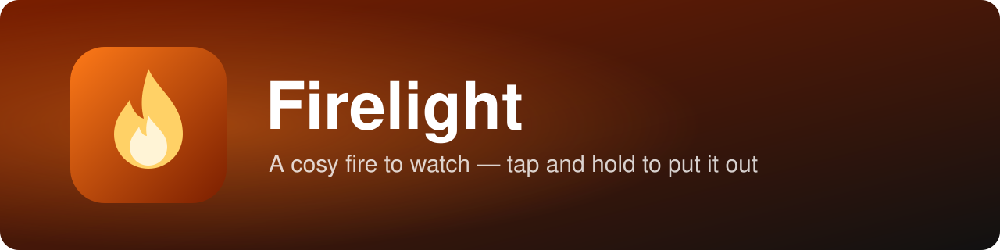

<p align="center"></p>

A full-screen fire simulation to sit and watch. Heat rises, swirls and cools into flickering flames, logs glow and crack into embers, and sparks ride the air. It has a firefighter twist: tap and hold to spray water and put it out, then hold again to strike a match and relight it.

## Features

- Grid-based heat and smoke simulation with sparks, embers and flickering light
- Tap and hold to hose the fire out (steam, smouldering embers, soaked wood relights slower)
- Hold again to relight; tap to poke, double-tap to add a log
- Crackling sound made with the Web Audio API (muted by default)
- Intensity slider, fullscreen and screen wake lock; adapts resolution on slow phones

## Running it

Plain HTML, CSS and JavaScript with no build step. Open `index.html` in a browser, or serve the folder:

```bash
python -m http.server 5531
```

## Limitations

- Side-on 2D fire, up to 7 logs, and logs never burn away
- Not yet tested live on a real phone
