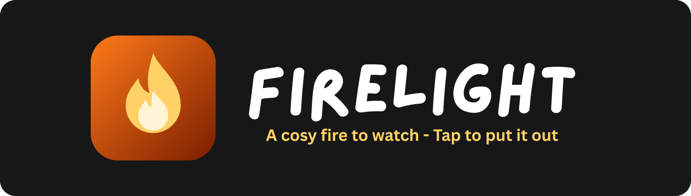
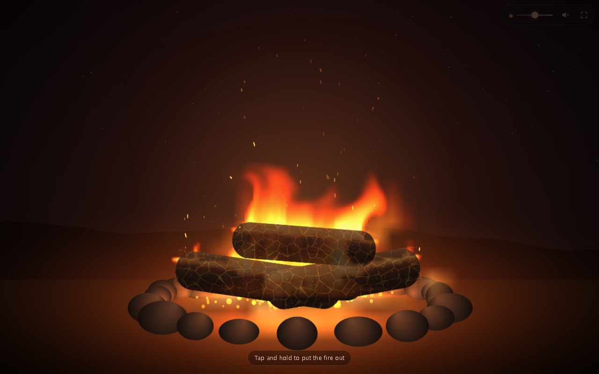

<p align="center"></p>

<p align="center">    </p>

A full-screen fire simulation to sit and watch. Heat rises, swirls and cools into flickering flames, logs glow and crack into embers, and sparks ride the air. It has a firefighter twist: tap and hold to spray water and put the fire out, then hold again to strike a match and bring it back.

<p align="center"></p>

## Features

- Grid-based heat and smoke simulation with sparks, embers and flickering firelight on the stones
- Tap and hold to hose the fire out, with steam, smouldering embers and soaked wood that relights slower
- Hold again to relight: sparks, catch, then spread
- Tap to poke the fire, double-tap to throw on another log
- Crackling sound synthesised with the Web Audio API (muted by default)
- Intensity slider, fullscreen and screen wake lock; drops resolution automatically on slow devices

## Getting started

No build step and no dependencies. Clone the repo and open `index.html`, or serve the folder locally:

```bash
git clone https://github.com/Squidly1408/firelight.git
cd firelight
python -m http.server 5531
```

Then visit http://localhost:5531.

## Project structure

| File | Purpose |
|---|---|
| `index.html` | Page and controls |
| `app.js` | Fire simulation, rendering and input |
| `audio.js` | Procedural crackle and hiss sounds |
| `style.css` | Styles |
| `assets/` | Logo and README images |

## Built with

HTML, CSS, JavaScript (Canvas 2D, Web Audio API, Screen Wake Lock API)

## Limitations

- Side-on 2D fire with up to 7 logs; logs never burn away completely
- Not yet tested live on a real phone, so frame rate on low-end devices is unverified

## License

Released under the [MIT License](LICENSE).
